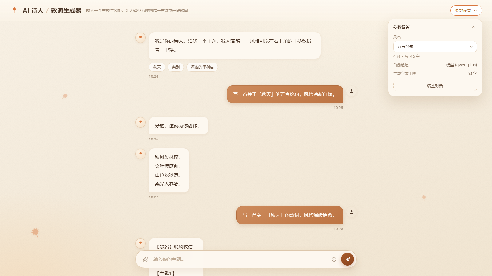
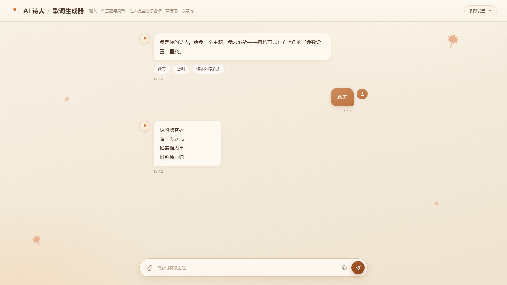

# 🍂 AI 诗人 / 歌词生成器

基于 **通义千问 / 阿里云百炼** 的诗词与歌词生成应用。输入一个主题、选一种风格，AI 为你创作古典诗词、现代诗或原创歌词。

界面是暖秋色系的单栏对话流：底部悬浮输入栏、右侧气泡是你说的话、左侧气泡是 AI 落笔，右上角折叠面板管参数。



生成效果（五言绝句，流式逐字落笔）：



支持两种调用通道，改一行配置即可切换：

| 通道 | `LLM_MODE` | 说明 |
|---|---|---|
| 模型 | `model` | 直接调 `qwen-plus` 等模型，只需 API Key |
| 智能体 | `agent` | 调百炼控制台里的**智能体应用**，需 API Key + **App ID** |

> 两者不是同一个东西：模型是「你给 prompt，模型给结果」；智能体是云端配好 prompt、知识库、插件的一整个应用，代码只能传输入。协议也不同——智能体走 Responses API，不是 `chat/completions`，URL 要带 App ID，且**不能传 model**。

---

## ✨ 功能

- **古典诗词**：五言/七言绝句、五言/七言律诗，prompt 里写死句数与每句字数（五绝 4×5、七绝 4×7、五律 8×5、七律 8×7），律诗额外要求对仗
- **现代诗**：自由分行、意象具体
- **原创歌词**：自动生成【歌名】【歌手】+【主歌】【副歌】结构，歌手要求虚构，不使用真实艺人姓名
- **流式输出**：SSE 边生成边显示，光标跟随；中途可点「停止」，**会同步中断上游请求**，不只是遮住画面
- **输入防护**：长度上限、零宽字符清理、7 类指令注入拦截
- **错误分类型**：Key 无效 / App ID 无效 / **账户欠费额度用尽** / 限流 / 超时 / 上游不可用 / 输入非法，各有独立提示与错误码
- **暖秋界面**：纸纹底、暖光渐变、五片枫叶点缀、两级暖色投影，全局无冷色

---

## 🚀 快速开始

### 1. 安装依赖

```bash
pip install -r requirements.txt
```

> 需要 **Python 3.10+**（FastAPI / pydantic v2 的要求）。依赖已全部锁定小版本。

### 2. 配置凭证

```bash
cp .env.example .env
```

`.env`：

```ini
DASHSCOPE_API_KEY=sk-你的Key
LLM_MODE=model
# 用智能体通道时改成：
# LLM_MODE=agent
# APP_ID=你的应用ID
```

也可以用环境变量（二选一）：

```powershell
# Windows（设置后需重开终端）
setx DASHSCOPE_API_KEY "sk-你的Key"
```

```bash
# macOS / Linux
export DASHSCOPE_API_KEY=sk-你的Key
```

> `.env` 已在 `.gitignore` 里，不会被提交。**不要把 Key 写进代码或 README。**

### 3. 运行

```bash
python app.py
```

浏览器会自动打开 `http://127.0.0.1:7860`（服务器部署时设 `OPEN_BROWSER=0`）。

配置有问题时进程会**直接退出并打印原因**，不会跑到一半才报错。

---

## 🔑 拿 App ID（用智能体通道才需要）

1. 登录 [阿里云百炼控制台](https://bailian.console.aliyun.com/)
2. 左侧「应用管理」→ 创建或选择一个**智能体应用**
3. 在应用卡片上复制**应用 ID**，填进 `APP_ID`
4. 确认应用已**发布**

> 智能体接口目前仅适用**华北2（北京）**地域。其他地域改 `API_HOST`。

---

## 📁 目录结构

```
ai-poet-generator/
├── app.py               # 入口：加载配置 → 组装 FastAPI → 启动 uvicorn
├── poet/
│   ├── config.py        # 配置层，启动即校验（pydantic-settings）
│   ├── styles.py        # 风格策略表，prompt 的唯一来源
│   ├── client.py        # LLM 客户端：双通道 + 超时 + 错误翻译
│   ├── service.py       # 业务层：输入校验 → 调用 → 输出归一
│   └── api.py           # 接入层：FastAPI + SSE 流式 + 并发闸门
├── web/                 # 前端（无框架、无构建步骤）
│   ├── index.html
│   ├── style.css
│   └── app.js
├── tests/               # 62 项自测，全部离线，不消耗额度
├── docs/preview.png
├── .env.example
└── requirements.txt
```

### 为什么不用 Gradio

设计要的是「单栏对话流 + 左右气泡 + 时间戳 + 底部悬浮输入栏 + 右上折叠参数面板」。Gradio 的气泡由组件自己渲染，时间戳、悬浮输入栏、折叠面板都做不出来，只能覆盖它的内部类名硬掰——Gradio 一升级就碎。换成原生 HTML/CSS/JS 后，视觉完全可控，`pip install` 也少掉 200MB+ 的 Gradio 前端资源。

代价是前端要自己维护，收益是样式不再依赖第三方 DOM 结构。

---

## 🔌 接口

| 方法 | 路径 | 说明 |
|---|---|---|
| `GET` | `/` | 页面 |
| `GET` | `/api/meta` | 风格列表、默认风格、通道信息、字数上限、快捷主题 |
| `GET` | `/api/health` | 健康检查 |
| `POST` | `/api/generate` | 生成，`text/event-stream` 流式返回 |

SSE 事件：

```
event: chunk   data: {"text": "已生成的完整文本（累积快照）"}
event: done    data: {}
event: error   data: {"code": "rate_limit", "message": "触发上游限流，请稍后再试。"}
```

输入不合法（空主题 / 超长 / 含注入特征）会在**开流之前**返回 `400` + `{code, message}`，不占用上游额度。

---

## 🧪 测试

```bash
python tests/test_config.py    # 11 项：配置校验与 URL 拼接
python tests/test_styles.py    #  9 项：风格表与 prompt 约束
python tests/test_client.py    # 15 项：双通道协议、错误翻译、重试策略
python tests/test_service.py   # 17 项：输入校验、注入防护、流式累积
python tests/test_api.py       # 10 项：SSE 帧格式、400 拦截、静态资源
```

共 **62 项**，用 `httpx.MockTransport` 与 `service.stream` 替身拦截，**不联网、不花额度、不需要真实 Key**。

> 已知缺口：并发闸门（`CONCURRENCY_LIMIT`）没有自动化测试，需要并发发起两个请求才能观察，单进程测试里不稳定。

---

## ⚙️ 可调参数

全部在 `.env` 里，代码中没有魔法数字：

| 参数 | 默认 | 说明 |
|---|---|---|
| `LLM_MODE` | `model` | `model` / `agent` |
| `MODEL_NAME` | `qwen-plus` | 仅 model 通道生效 |
| `TEMPERATURE` | `0.9` | 仅 model 通道生效 |
| `TIMEOUT_S` | `60` | 单次调用硬超时。SDK 默认是 **600 秒**，必须覆盖 |
| `CONNECT_TIMEOUT_S` | `5` | 连接超时 |
| `MAX_RETRIES` | `2` | 传输层重试次数（SDK 内置，识别 429/5xx，401 不重试） |
| `CONCURRENCY_LIMIT` | `8` | 同时进行的生成任务上限，超出排队 |
| `MAX_THEME_CHARS` | `50` | 主题长度上限 |
| `OPEN_BROWSER` | `1` | 启动后是否自动开浏览器 |

---

## ❓ 常见问题

**Q：启动报 `缺少 DASHSCOPE_API_KEY`**
没配 Key。检查 `.env` 是否存在且 `DASHSCOPE_API_KEY` 有值；用 `setx` 设置的环境变量需要**重开终端**。

**Q：`LLM_MODE=agent` 启动报缺 APP_ID**
智能体通道必须有 App ID，见上面「拿 App ID」。暂时没有就先用 `LLM_MODE=model`。

**Q：报「账户可能欠费或额度用尽」**
上游返回的是 `400 Access denied ... overdue-payment`。Key 本身有效，是阿里云账户状态问题（欠费、免费额度用完、模型未开通），去百炼控制台看账户。注意这类 400 和「App ID 无效」是两回事，曾经混为一谈，现在分开提示。

**Q：报「APP_ID 无效、应用未发布或无访问权限」**
只会在 `agent` 通道出现。三种可能：App ID 抄错、应用没发布、应用在其他业务空间（需要工作空间 ID）。

**Q：生成到一半点「停止」，还会扣 token 吗？**
不会。前端 abort 会断开连接，服务端检测到断开后给后台线程打停止标记，worker 退出循环时 SDK 连接随之关闭。

**Q：一个卡住的请求会不会把整个应用锁死？**
以前会——SDK 默认 600 秒超时 × 3 次重试 = 最坏 30 分钟，配合 Gradio 默认并发 1，全站等待。现在超时降到 60 秒，同步调用跑在独立线程、不占用事件循环，再加上并发闸门限制同时打上游的次数。

---

## 📄 说明

- 生成的诗词/歌词均为 AI 原创，不涉及他人版权。
- 本项目通过环境变量读取 Key，代码与仓库不含任何密钥。

## 📜 License

MIT
